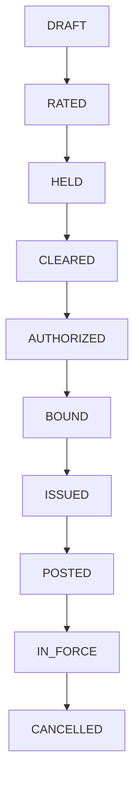
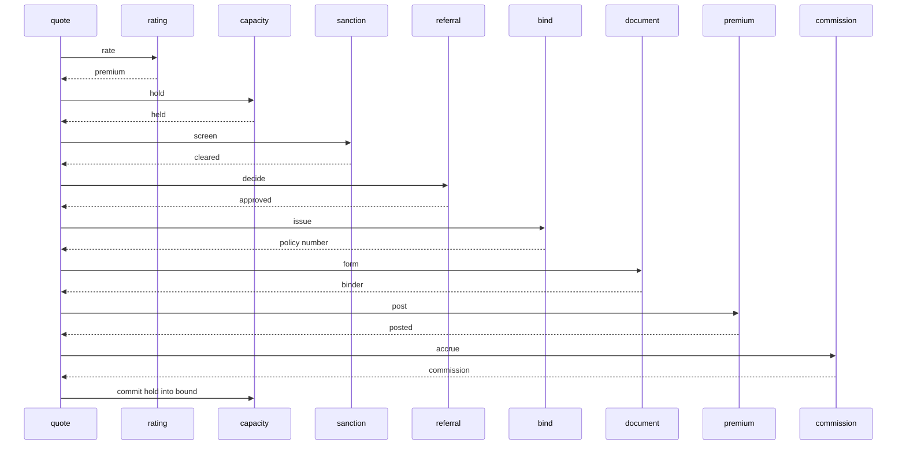

# Policy Bind

A broker submits a quote for an applicant. Thirteen services each own one Postgres database. The quote service is the saga orchestrator. It does not call the others over HTTP. A step commits its own row and an outbox message in one local transaction. A relay publishes that message. If a later step fails, the orchestrator writes compensating commands for the steps that already committed.

The treaty keeps two numbers: held cents for a quote that is not yet in force, and bound cents for premium that has been posted. A quote moves the same amount from held to bound when commission is accrued. Cancelling before that releases the hold. Cancelling an in-force policy returns the unused days and releases only that return from bound. Those two numbers are the treaty. The limit is `held + bound`.



An amount above `1000000` cents is above underwriter authority and is referred. `1000000` is written without a referral. An approver token whose text contains `denied` is rejected onto a dead-letter queue. A token whose text contains `decline` rejects only a referred quote. A name whose text contains `sanction` is screened onto a dead-letter queue. A form token whose text contains `broken` never issues a binder. A premium token that ends in `0000` is declined. One risk, the applicant plus the product, receives one policy number.



The return is `premium * unused days / term days`, integer division. Commission is ten percent of the premium, and the clawback is ten percent of the return.

## Services

| Service | Owns | Port |
| --- | --- | --- |
| account-service | the applicant and the email | http://localhost:8201 |
| product-service | the rate and the term | http://localhost:8202 |
| quote-service | the saga | http://localhost:8203 |
| rating-service | the integer premium | http://localhost:8204 |
| capacity-service | the treaty limit, the hold, and the bound premium | http://localhost:8205 |
| referral-service | underwriter authority | http://localhost:8206 |
| sanction-service | the name screen | http://localhost:8207 |
| bind-service | the policy number | http://localhost:8208 |
| document-service | the binder | http://localhost:8209 |
| premium-service | the premium receivable and the return | http://localhost:8210 |
| commission-service | the broker commission and the clawback | http://localhost:8211 |
| endorsement-service | the cancel record | http://localhost:8212 |
| audit-service | one row per fact | http://localhost:8213 |

Postgres is `localhost:5443`. Kafka's host listener is `localhost:9104`. RabbitMQ management is http://localhost:15683.

## Run

```bash
mvn -q -DskipTests package
docker compose up --build -d
./scripts/smoke.sh
docker compose down
```

```bash
curl -s -X POST localhost:8201/accounts \
  -H 'content-type: application/json' \
  -d '{"name":"Ada Marine","email":"ada@shop.test"}'

curl -s -X POST localhost:8202/products \
  -H 'content-type: application/json' \
  -d '{"code":"HULL","rateCents":2500,"termDays":365}'

curl -s -X POST localhost:8205/treaties \
  -H 'content-type: application/json' \
  -d '{"code":"HULL-T","limitCents":100000}'

curl -s -X POST localhost:8203/quotes \
  -H 'content-type: application/json' \
  -d '{"requestId":"q-1","accountId":"ACCOUNT","productCode":"HULL","treatyCode":"HULL-T","units":2,"approverToken":"lead-ok","formToken":"FORM-1","premiumToken":"PREM0001"}'
```

The same `requestId` returns the original quote and does not hold a second time. Two units at 2500 cents bind 5000 cents. After commission, those 5000 cents are bound and the hold is gone.

## Where the same split goes on Google Cloud

This repository runs on Compose. Nothing in it calls a cloud account, and there is no Pub/Sub client in the process.

| Compose | Google Cloud |
| --- | --- |
| Postgres 16 | Cloud SQL for PostgreSQL |
| Kafka 3.8 | a Pub/Sub topic for the quote log, or a managed Kafka |
| RabbitMQ 3.13 | a Pub/Sub subscription with a dead-letter topic |
| the thirteen services | Cloud Run or GKE |

## Local credentials

The Compose network is open. Do not publish these ports.

| | |
| --- | --- |
| Postgres | `platform` / `platform` |
| RabbitMQ | `platform` / `platform`, vhost `/` |
| HTTP | no authentication |

## Tests

`mvn test` checks the authority threshold, the name screen, the form, the premium token, the pro-rata return, the commission, and the compensation matrix. `./scripts/smoke.sh` binds a policy, replays its request id, cancels a price overflow, a sanction, a declined referral, a denied approver, a broken form, and a declined premium, returns unused days on an in-force policy, and runs two overlapping cases: four quotes against a treaty of three, and two quotes for one risk.

## Same shape, different domain

- [Live Lobby](https://github.com/joshbarros/java-live-lobby)
- [Loyalty Ledger](https://github.com/joshbarros/java-loyalty-ledger)
- [Claims Desk](https://github.com/joshbarros/java-claims-desk)
- [Checkout Counter](https://github.com/joshbarros/java-checkout-counter)
- [Study Hall](https://github.com/joshbarros/java-study-hall)
- [Clearing Desk](https://github.com/joshbarros/java-clearing-desk)
- [Thread Hall](https://github.com/joshbarros/java-thread-hall)
- [Yard Gate](https://github.com/joshbarros/java-yard-gate)
- [House Account](https://github.com/joshbarros/java-house-account)
- [Procure to Pay](https://github.com/joshbarros/java-procure-to-pay)
